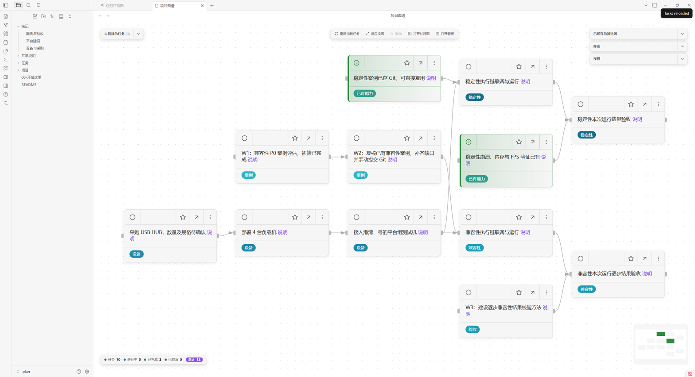
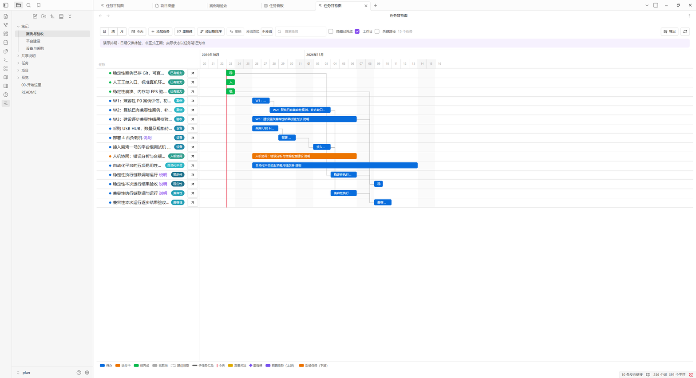

# 兼容性与稳定性测试计划

用 Obsidian + Project Planner 管理同一批任务的关系图、甘特图、看板和笔记，并通过 Git 共享 Markdown 源文件。

先阅读 [00-开始这里.md](00-开始这里.md)。排期为明确标注的演示数据，实际状态根据需求记录。

## 打开

在 Obsidian 中选择“打开本地仓库”，打开本目录。插件文件已为当前电脑下载。其他成员拉取后运行：

```powershell
powershell.exe -NoProfile -ExecutionPolicy Bypass -File ".\共享说明\初始化演示.ps1"
```

如 Obsidian 显示插件信任或安全确认，请阅读并自行确认本演示库使用的 Project Planner 和 Dataview。

## 数据约定

- 任务、日期、状态和依赖：`任务/测试工作计划.md`。
- 背景、标准和待确认事项：`项目/`、`笔记/`。
- 插件版本及校验值：`共享说明/plugin-lock.json`。
- Git 共享方法：`共享说明/Git共享.md`。
- 本机窗口布局、缓存、下载的插件代码和验证截图不进入共享仓库。

共享远程仓库：https://github.com/linjinglan/plan.git 。创建分支和执行提交前，按操作者要求确认完整分支名与提交信息。

## 实际界面预览

以下是本机实际插件截图。日期为演示排期，不是正式工期。




